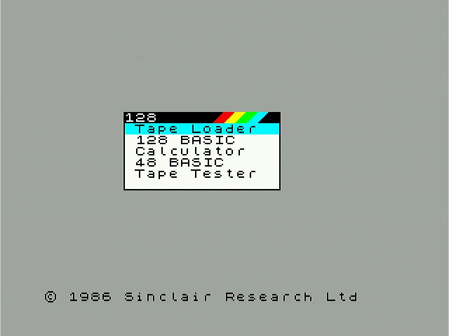
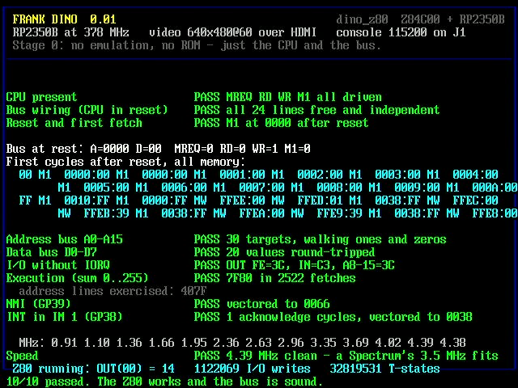

# frank-dino

Firmware for the **dino_z80** board: an RP2350B acting as the entire
machine — clock, memory, I/O, video — for a real Zilog Z84C00 sitting next
to it in a socket.

The Z80 is not emulated. It fetches, it drives ~MREQ and ~RD and ~WR, and
everything on the other side of those pins is software on the RP2350B.

Ported from [frank-xt8086](https://github.com/rh1tech/frank-xt8086), which
does the same thing for a real 8086. The toolchain, the bench scripts, the
video timing and the structure are that firmware's; the bus engine is not,
because the two CPUs share none of the signals that matter.



## What it is now

A **ZX Spectrum** and some forty of its relatives, with sound, storage
and a settings page — all of it executed by a Z84C00 in a socket, with
the RP2350B being everything else the CPU can see.

| | |
|---|---|
| Machines | 16K, 48K, 128K, +2, +2A, +3; Pentagon 128, 512 and 1024SL; Scorpion ZS-256 and ZS-1024 (ProfROM), ScorpEvo; Nemo KAY-256, KAY-1024 (two ROMs), ZXM-Phoenix; Profi 1024 with DS80 and CP/M; ATM-Turbo 1, 2, 2+ (two BIOSes) and 3 (all 4 MB); ZX Evolution BaseConf (EVO Reset Service, its Magic NMI menu, EVO ProfROM, NEO-DOS; 4 MB); Timex TC2048 and TC2068; Didaktik Gama 89; Leningrad-1 and -2; Byte; ALF TV Game. Spanish ROMs for the 48K, 128K and +2 |
| CPU | A real Z84C00 at each machine's own clock (3.5, 3.5469 or 3.528 MHz), paced by the wall clock; 5.3 and 7 MHz on request |
| Timing | Every handler is told its T-state: the ULA's contention and floating bus on the Sinclair machines, a picture built as the ULA fetched it (multicolour, border effects), Gigascreen with an Auto mode |
| RAM | 128 KB in SRAM; up to 1 MB more in the 8 MB PSRAM (4 MB on the ATM-Turbo 3 and the Evo), at #C000 through a staging page or anywhere at all through the XIP cache (the ATM) |
| Video | 256x192 and border doubled into 640x480 over HDMI; ULA+, Gigascreen, the Timex modes, Pentagon 16 colours, Profi 512x240, ATM EGA/hires/80x25 text with its palette; palettes (Sinclair, Pulsar, Alone, Grayscale, Mars, Ocean), four scanline strengths and a CRT filter with an aperture grille, all dithered onto the ladder at no cost per pixel |
| Sound | Beeper, two AYs (TurboSound and TurboSound FM's YM2203s), SAA1099 and the CMS pair, OPL3, YM2413, two SN76489s, Covox (#FB or #DD), SounDrive, SpecDrum, the Byte's 8253 -- synthesised on core 0 from timestamped writes, stereo to two PWM DACs |
| Tape | `.tap`, `.tzx` (every block type, GDB included), `.pzx`, `.csw`, `.wav` in real time onto the EAR bit, or instantly by ROM trap when a tape is all standard blocks; a real cassette on J8; a worn-tape model (wow, lurches, dropouts); a tape browser; SAVE recorded back to `.tap`; Rodolfo Guerra timings |
| Snapshots | `.sna` and `.z80` in; `.z80` v3 out, ten quick-save slots, a register page -- the registers read from the real CPU by NMI |
| Disks | Beta Disk with TR-DOS 5.03, 5.04T, 5.04TM, 5.05D or 6.11e: `.trd`, `.scl`, `.fdi`, `.udi`, `.td0` in drive A, three more `.trd` drives read straight from the card; the +3's uPD765 with weak sectors and the Speedlock trick; DivMMC/esxDOS and a Z-Controller on its card image; an IDE hard disk behind NEMO, DivIDE, ATM or the Scorpion's SMUC (with its 24LC16 NVRAM and clock, so ProfROM keeps its setup) |
| Input | The full matrix over USB or the console, mapped the way pico-speccy and SpeccyP map it; USB gamepads -- generic, DualShock 4, DualSense and XInput -- with every button mappable to a fire bit or a key, and named maps on the card; mice as a Kempston mouse with wheel, and as the Profi's serial mouse; Kempston (three fire buttons), Sinclair 1 and 2, Cursor and Fuller joysticks; Pause |
| Other | Mr Gluk's clock with its NVRAM on the card, Interface 2 and ALF cartridges, a machine's ROM from `/roms` on the card, settings profiles, POKE, `.gz` and `.zip` |
| Menus | pico-speccy's layout in the 128K's own style -- the Spectrum's ROM font, the rainbow title bar, the cyan bar -- on their own 320x240 surface |

Five of those are worth a sentence each, because they are not what an
emulator does.

**Snapshots.** You cannot write a Z84C00's registers from outside it, so
a `.sna` or a `.z80` is restored by *generating a program that loads
them* and mapping it over the ROM window: the CPU loads itself and jumps
into the snapshot, and the real ROM comes back on the first fetch after
the jump. See `src/spectrum/launch.c`.

**The PSRAM is not optional.** U9 is soldered down and the firmware
treats it that way: the disk and tape images, the menus' framebuffer,
the machines above 128 KB and the inflate window all live there, and
`main()` stops with a message on the console rather than coming up in
some reduced form. There is no useful subset to fall back to, and
pretending there is only hides a board fault.

**A megabyte of guest RAM on a part with half of one.** The bus engine
reads guest memory on every cycle, so what is *mapped* has to be in
SRAM — a PSRAM miss there stretches a clock phase. But a Profi's 1 MB is
mostly not mapped: the first eight banks are the 128K machine it also
is, and the rest only ever appear in the window at #C000, one at a time.
So banks 0-7 live in SRAM and the rest in PSRAM, with one 16 KB staging
page holding whichever high bank is current. A switch costs two 16 KB
transfers, on a path that happens hundreds of times a second and not
hundreds of thousands. See `spec_bank_ptr()`.

**Sixty-four colours out of four levels.** The video is a two-resistor
ladder: two bits a channel, sixty-four colours, and that is the ceiling.
ULA+ asks for sixty-four *arbitrary* ones. It works because every
Spectrum pixel is already doubled into a 2x2 block of output pixels,
which is exactly one Bayer cell -- so each colour is dithered inside its
own pixel and the averaging is the eye's. Gigascreen uses the same block
to show banks 5 and 7 at once, blended in space instead of flickering in
time. See `src/drivers/vga/vga.c`.

**Tape.** The same problem, once more: a `.tap` is served by trapping the
ROM's `LD-BYTES`, and the trap needs IX, DE and A — which it gets by
patching a stub into the ROM that pushes each of them out through a port
this firmware is listening on. See `src/spectrum/tape.c`.

**Disks.** The Beta Disk's ROM paging has no port at all: TR-DOS replaces
the BASIC ROM when the CPU fetches an opcode from 0x3Dxx and disappears
on the first fetch at 0x4000 or above. The bus engine's opcode-fetch hook
sees exactly what the interface's address comparator saw. See
`src/spectrum/beta.c`.

`docs/spectrum.md` has the whole of the machine: what each setting does,
which parts of each file format are supported, and what is deliberately
out of scope.

## Stage 0: proving the bus first

Stage 0 still exists, and is where this started.



Build it with `SELFTEST=ON`; the default build boots the Spectrum and
runs only the two non-destructive checks on the way past.

This was **stage 0**: a test firmware. There is no ROM, no emulated
machine, and nothing to boot. Its whole job is to answer one question
before a ZX Spectrum emulator is built on top of it — *does the Z80 work,
and does this board's idea of a bus match the Z80's?*

It runs ten tests on the physical CPU and reports the result over HDMI
and over the console:

| Test | Proves |
|------|--------|
| CPU present | Something is driving ~MREQ, ~RD, ~WR and ~M1 at rest |
| Bus wiring | With the CPU in reset, all 24 bus lines follow a pull and none is shorted to another |
| Reset and first fetch | ~RESET works and the CPU comes up fetching from 0000h |
| Address bus A0-A15 | Thirty targets reached by `JP`, walking ones and zeros |
| Data bus D0-D7 | Twenty values round-tripped out as an operand and back as written data |
| I/O without IORQ | `OUT` and `IN` are recognised from ~MREQ alone |
| Execution | The CPU sums 0..255 and gets 7F80h — flags, branches, 16-bit stores |
| NMI | GP39 vectors the CPU to 0066h |
| INT in IM 1 | GP38 produces an acknowledge cycle and vectors to 0038h |
| Speed | How fast the bus engine can clock the CPU and still be right |

Then it leaves the Z80 running a counting loop and puts the count on the
screen, so a still photograph distinguishes a finished report from a dead
machine.

On the first board built, all ten pass and the Z80 clocks cleanly at
**4.4-4.5 MHz** — comfortably above the 3.5 MHz a ZX Spectrum needs,
which is the question stage 0 existed to answer.

It earned its keep before that, too. The first CPU fitted to this board
failed seven of the ten, and the report named the fault without a scope:
D2-D6 held low past the 200R resistors, and A1 stuck at the CPU's own pin.
A replacement passed everything. The two halves of that diagnosis come
from different tests on purpose — the wiring test runs with the CPU in
reset and can only see faults that persist when its outputs are
high-impedance, and an output driver that fails *while driving* is
invisible to it, which is why the address lines are also checked against
the program counter while the CPU runs.

## Quick start

```sh
make hooks                      # once, per clone
./build.sh                      # build
./swd_flash.sh                  # flash through the Debug Probe on J4
./capture.sh shot               # photograph the screen
./keys.sh --tab                 # open the file browser
./keys.sh --down --enter        # pick something and run it
./keys.sh 'beep 1,0' --enter    # or type at the machine and listen
```

`keys.sh` is the point of the last three: with no keyboard plugged in the
console *is* the keyboard, so the whole machine can be driven from a
script over the same cable that flashes it. "Does it still boot, load a
game and run it" is a question a test can answer with a screenshot.

Inside the browser: the arrows move, Enter opens, Backspace goes up, any
letter or digit jumps to the next entry beginning with it, backslash
opens the settings page, and Tab goes back to the machine.

With a real keyboard (a `USB_KEYBOARD=ON` build) the browser is on **F1**
rather than Tab, because every key a Spectrum has belongs to the matrix
— and that build has no console to press Tab at.

## What the board gives the Z80

| Part | This firmware |
|------|---------------|
| Clock | Generated in software on core 1, edge by edge |
| RAM | Four 16 KB windows; the Spectrum aims them at its eight banks |
| ROM | A window whose write pointer goes to a bit bucket |
| I/O | Two function pointers, re-pointed by whatever machine is running |
| Video | 640x480 at 60 Hz — 80x30 text, or the ULA's screen |
| Sound | Two PWM DACs, left on GP46 and right on GP44, fed 44100 stereo samples a second by the frame loop |
| Storage | microSD on SPI1, and 8 MB of PSRAM for what will not fit in SRAM |
| Console | USB CDC on the USB-C socket. There is no UART; a `USB_KEYBOARD` build has no console at all |

## How the bus engine works

The interesting constraint is that **~WAIT is strapped to VCC**, so the
CPU cannot be stalled. On a CPU with its own oscillator that would mean
every bus cycle had to be answered inside a hard deadline.

It is not, because the clock is ours. Core 1 runs a loop that drives GP28
high, waits, answers whatever the Z80 has asked for, drives it low, waits,
and answers again — two samples per T-state. The Z84C00 is fully static,
so a phase that runs long is just a long phase, and there is no clock
speed at which this becomes *incorrect*. What sets the speed is how long
the answer takes, which is what the speed test measures and what makes the
number it reports the one that matters for stage 1: a ZX Spectrum needs
3.5 MHz.

Two consequences are worth knowing before reading `src/core/z80_bus.c`:

- **The service routine is edge-triggered on the strobes.** The first
  version was level-driven, which is correct for a read — answering twice
  with the same byte is answering once — and wrong for everything else.
  ~WR is low across two samples, so every `OUT` dispatched four times.
- **~IORQ is not connected.** An I/O cycle is inferred from ~RD or ~WR
  active while ~MREQ is idle, and an interrupt acknowledge from ~M1 active
  with ~MREQ never following. Both inferences are tested on the real CPU,
  which is the only place they can be.

`docs/pinout.md` has the rest of the hardware, including what else is not
connected and why the clock is the one signal that goes through a buffer.

## Layout

```
src/
  core/            the pin map, the bus engine, the guest's memory
  test/            the stage-0 suite and the Z80 programs it runs
  spectrum/        the machine: paging, ULA ports, AY, tape, disks, settings
  drivers/vga/     640x480, PIO and DMA out of the R2R ladder
  drivers/audio/   the PWM DAC and its ring buffer
  drivers/sdcard/  SPI1 to J3, and FatFs on top of it
  drivers/psram/   the 8 MB on XIP CS1
  drivers/usbkbd/  TinyUSB as a HID host
  ui/              the report, the file browser and the settings page
  app/             main.c, the linker script, the top-level CMakeLists
boards/            the SDK board header
roms/              the ROM images, and where they came from
docs/              the pin map and the machine
tools/             the attribution checker the hooks and CI share
```

`boards/` sits outside `src/` because it is configuration the build reads,
not code the firmware compiles: `PICO_BOARD_HEADER_DIRS` points the SDK at
it and the SDK expects it at the repository root.

The Z80's test programs are hand-assembled byte arrays in
`src/test/z80_progs.h`, with the listing in the comment beside each one.
That is deliberate: these are the bytes that prove the data bus works, and
an assembler between the listing and the binary is one more thing that can
be the reason a test fails.

## Building

```sh
./build.sh
```

`src/app/CMakeLists.txt` is the top of the build — `cmake -S src/app -B build`
if you would rather drive it directly.

| Variable | Default | What it does |
|----------|---------|--------------|
| `CPU_SPEED` | `504` | System clock, MHz |
| `SELFTEST` | `OFF` | Build the destructive stage-0 suite instead of the machine |
| `USB_KEYBOARD` | `OFF` | TinyUSB as a HID host rather than a CDC console |
| `CLEAN` | `0` | Delete the build tree first |

`CPU_SPEED` sets the ceiling on how fast the Z80 can be clocked, and
nothing else — it cannot make this firmware *wrong*, only slow. 378 MHz
needs only the 1.30 V regulator setting and was the default through stage
0. The Spectrum wants more: the frame loop also renders two AY chips and
pushes 882 samples, and at 378 MHz the clock tuner ran out of headroom
and the machine ran twelve per cent slow. 504 MHz and 1.60 V is what it
takes, and is proven on this board.

## The bench toolset

Three things plug into the board, and there is a script for each.

### SWD — flashing and debugging

A Raspberry Pi Debug Probe on **J4** (pin 1 SWDIO, pin 2 GND, pin 3
SWCLK).

```sh
./swd_flash.sh                  # program, verify, reset, run
./swd_flash.sh --reset-only     # just restart what is already there
./debug.sh                      # build, flash, break at main, run under GDB
make swd-check                  # is the debug port reachable, and how reliably
```

**The reset matters.** `swd_flash.sh` does `program ... verify`, then
`reset halt`, then `resume` — not OpenOCD's own `program ... reset`. That
default does not reliably stop core 1 on this chip, and this image is
`copy_to_ram`: core 0 comes out of reset and starts copying the new image
into RAM while core 1 is still executing the old one out of the same RAM.

It presents as a firmware that hangs in a different place on every build,
with no fault flags set, core 0 healthy, and core 1's program counter
sitting in the bootrom. That is an extremely convincing impression of a
hardware fault. If this firmware ever starts behaving that way again,
check how it was reset before suspecting anything else.

`./flash.sh` is the USB-BOOTSEL fallback: hold S3, press S4, and the board
appears as a drive.

The image is `copy_to_ram`, which confuses software breakpoints set before
the copy runs — `monitor reset halt; load; break main` in that order, as
`debug.sh` does it.

**If OpenOCD says `Error connecting DP: cannot read IDR`,** check the
cable orientation before anything else. J4 has GND in the middle, so a
cable plugged in backwards keeps its ground and swaps the other two —
which looks exactly like an unpowered board. A Debug Probe's own
connectors use the opposite order from J4's (the Pico convention is
SWCLK, GND, SWDIO), so a straight-through cable needs turning round.

### USB — the console

stdio is **USB CDC** on the board's USB-C socket (J5), with S1 set to
device mode. There is no UART on this board: GP44 is the right audio
channel and GP45 the tape input, and nothing brings a UART out.

```sh
./console.sh                    # picocom or screen on the board's CDC port
```

`console.sh` and `keys.sh` find the board by its USB descriptor rather
than taking the first `/dev/cu.usbmodem*`, because a Debug Probe
enumerates a CDC port of its own — and on this board that port is
connected to nothing, so picking it is silent.

A `USB_KEYBOARD=ON` build has no console at all: S1 points the USB
controller at the hub, the firmware is a host, and the screen is the only
report there is. Flash it over SWD.

### HDMI capture — seeing the screen from a script

This board has no VGA connector: the ladder feeds an MS9288A (U16) which
drives J9, so HDMI is the only output. A MACROSILICON MS21xx capture
stick on the far end enumerates as `USB Video` and gives **640x480 at
60 fps** in UYVY — the same mode the firmware emits, so a character cell
survives the round trip and an 80x30 report is legible in a still.

```sh
./capture.sh                    # one frame to out/screen.png
./capture.sh clip 10 out/b.mp4  # ten seconds
./capture.sh view               # live preview
./capture.sh modes              # what the stick will give you
```

This makes "did stage 0 pass" a question a script can answer.

## What comes next

The machine runs, loads and plays, and every machine on the list is in.
What it will not do is run the 7 and 14 MHz turbo clocks of the ATM and
the Evo, which a real Z84C00 on this bus does not reach.

## Toolchain

- Pico SDK 2.2.0. `sdk_env.sh` finds it — an exported `PICO_SDK_PATH` wins
  only if it actually contains an SDK, because a stale export onto an
  unmounted volume is a confusing way to fail.
- Arm GNU Toolchain 14.x (`arm-none-eabi-gcc`)
- CMake 3.13+
- OpenOCD with `cmsis-dap` and `target/rp2350.cfg`
- `picotool` for the USB path, `ffmpeg` for capture, `picocom` or `screen`
  for the console

## Attribution

This repository's history names the people responsible for it and nobody
else. A co-author trailer naming a tool is not a courtesy — it puts that
tool in GitHub's contributor list, where it stays until the history is
rewritten.

`tools/check-attribution.sh` is the one implementation of that rule, and
the hooks and CI both call it.

```sh
make hooks               # once per clone; also runs the self-test
make check-attribution   # scan what this branch adds over the remote
```

## Credits

Much of the machine above the bus is ported from other people's work, all
of it GPL-3.0 or compatible, and each ported file says so at its top:

- **pico-speccy** (https://github.com/drewpo28/pico-speccy) by drew.po28 —
  the machine models (Pentagon 512/1024, Scorpion/ProfROM/KAY/Phoenix,
  ATM-Turbo, the ZX Evolution's BaseConf and its tools/evo_sim.c, Byte, ALF, Profi DS80), the FM and PSG cores, the tape timings,
  the TD0 decoder, the Kempston mouse decode, SMUC, the tape wear model, the
  pad decoders and button map, the palettes and CRT filter, and the menus.
- **ESPectrum** by Víctor Iborra [Eremus] and David Crespo [dcrespo3d], from
  which pico-speccy grew, and ZX-ESPectrum-Wiimote, Ramón Martinez and
  Jorge Fuertes, and Pete Todd's paseVGA before it.
- **MAME** — fm.cpp, ymf262.cpp and ym2413.cpp by Jarek Burczynski and
  Tatsuyuki Satoh, under the FM cores; the Scorpion and ATM hardware
  derivations.
- **UnrealSpeccy** — the ATM memory manager and the Teledisk loader.
- **Fuse** — the contention patterns and the first contended T-states, and the +3's Speedlock trick.
- **SpeccyP** — the keyboard's extra keys.
- **usb64** by Ryan Wendland — the XInput class driver (MIT).
- **ZXMAK2 / UnrealSpeccy** — the 24LC16 model behind SMUC's NVRAM.
- **Sinclair Research** — the menus' font is the 48K ROM's own.

The ROM images are their owners'; `roms/README.md` says where each came
from.

## Licence

GPL-3.0-or-later.

The 8x16 font is carried over from frank-xt8086.
